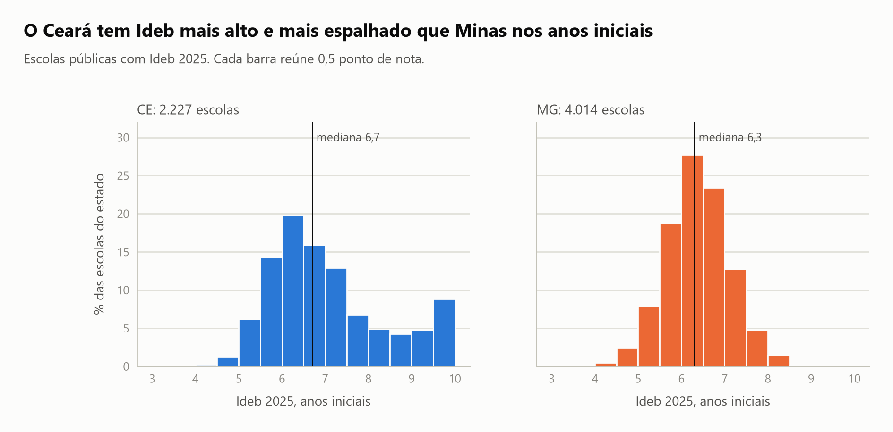
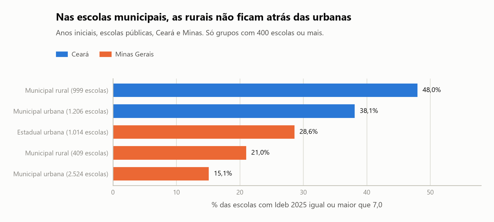
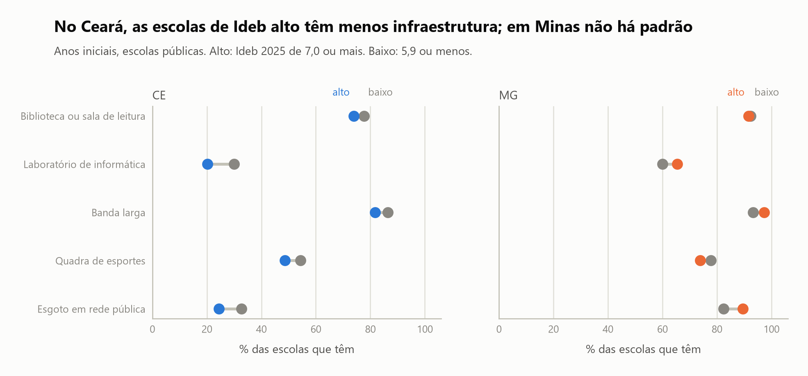

# P08. SQL avançado sobre o Censo Escolar e o Ideb

**Nº 8 de 37 na ordem de execução.** ID do projeto: P08.

**Cursos da Alura a fazer antes deste projeto (todos os que caem aqui na ordem das 4 carreiras):**
- AD/N1-04 - Realizando consultas com SQL: Joins, Views e transações
- AD/N1-05 - SQLite online: Análise de dados com SQL

Um banco relacional com dados reais da escola pública brasileira, montado em SQLite, para responder uma pergunta com SQL: o que distingue, no papel, as escolas de Ideb alto das de Ideb baixo? Junto o Censo Escolar 2025 (escola, matrícula, turma, docente, gestor e curso técnico), o Ideb 2025 por escola e as taxas de rendimento 2025, todos do INEP e ligados pelo código da escola. Para o banco caber em um SQLite e o recorte ficar comparável, fico com Minas Gerais e Ceará, e a pergunta é sobre os anos iniciais do ensino fundamental, a etapa com mais escolas no recorte.

## Os dados

O Censo Escolar 2025, na versão 2 dos microdados (537 MB compactados, <https://download.inep.gov.br/dados_abertos/microdados_censo_escolar_2025_.zip>), traz seis tabelas em CSV e o dicionário de dados. Matrícula, turma, docente e gestor não são listas de alunos, turmas e professores: cada uma tem uma linha por escola, com quantidades por etapa. Só o curso técnico tem várias linhas por escola. Escolho 27 das 290 colunas da tabela de escolas (identificação, tipo, infraestrutura, tecnologia e equipe) e as colunas de quantidade por etapa das demais.

O Ideb 2025 por escola vem em uma planilha para cada etapa, divulgado em agosto de 2026:
- anos iniciais: <https://download.inep.gov.br/ideb/resultados/divulgacao_anos_iniciais_escolas_2025.zip>
- anos finais: <https://download.inep.gov.br/ideb/resultados/divulgacao_anos_finais_escolas_2025.zip>
- ensino médio: <https://download.inep.gov.br/ideb/resultados/divulgacao_ensino_medio_escolas_2025.zip>

As taxas de rendimento 2025 por escola (aprovação, reprovação e abandono) são outra planilha: <https://download.inep.gov.br/informacoes_estatisticas/indicadores_educacionais/2025/tx_rend_escolas_2025.zip>.

As planilhas têm título e notas antes do cabeçalho, notas de rodapé no fim e um traço (`-` no Ideb, `--` nas taxas) onde não há dado. Os arquivos ficam em `data/`, fora do Git (ver `.gitignore`), e o banco gerado, `escolas_mg_ce.db`, fica na mesma pasta.

## O banco

São dez tabelas e uma view. Todas apontam para a tabela `escola` por chave estrangeira, e a chave é o código da escola do INEP.

| Tabela | Linhas | Chave |
|---|---|---|
| escola | 34.191 | `CO_ENTIDADE` |
| matricula | 23.477 | `CO_ENTIDADE` |
| turma | 23.477 | `CO_ENTIDADE` |
| docente | 23.477 | `CO_ENTIDADE` |
| gestor | 23.626 | `CO_ENTIDADE` |
| curso_tecnico | 5.559 | `CO_ENTIDADE` e `CO_CURSO_EDUC_PROFISSIONAL` |
| ideb_iniciais | 9.477 | `ID_ESCOLA` |
| ideb_finais | 7.654 | `ID_ESCOLA` |
| ideb_medio | 3.334 | `ID_ESCOLA` |
| rendimento | 16.301 | `CO_ENTIDADE` |

A view `resumo_escola` junta escola, matrícula, turma, docente e os três Ideb com `LEFT JOIN`, para nenhuma das 34.191 escolas sumir, e calcula alunos por turma, alunos por docente e a proporção de docentes com ensino superior. A checagem de chaves estrangeiras do SQLite não achou violação.

Na tabela de escolas, 24.069 são de Minas e 10.122 do Ceará. No Brasil, 180.540 das 214.192 escolas estão em atividade, 29.780 estão paralisadas e 3.872 foram extintas no ano do Censo.

## O que o SQL mostrou antes da análise

Três resultados sobre como juntar as tabelas pesam mais do que qualquer número do Ideb.

O tipo de join muda a contagem sem erro. As 34.191 escolas do recorte contra 23.477 com matrícula: um `INNER JOIN` esconderia as outras 10.714. Entre elas, 149 estão em atividade e não têm matrícula (75 privadas, 72 municipais e 2 estaduais), e eu não sei por quê.

O join de um para muitos infla a soma. Os 5.559 cursos técnicos pertencem a 2.061 escolas. Somar a matrícula pelo join dá 4.451.345 alunos, contra 986.139 na soma correta, 4,5 vezes mais, sem nenhum erro do SQL.

O Ideb é a nota padronizada do Saeb vezes o indicador de rendimento. Conferi nas 6.241 escolas dos anos iniciais com Ideb 2025: a diferença entre a conta e o valor publicado é de no máximo 0,05, o arredondamento. Por isso não uso a aprovação para explicar o Ideb, já que ela faz parte dele.

A transação foi testada com um lote de três inserções, em que a última viola a chave estrangeira. Com `commit` só no fim, o `rollback` devolveu o banco a 34.191 escolas e 23.477 matrículas, inclusive sem as duas inserções válidas. Com `commit` depois de cada uma, as duas ficam gravadas e o banco fica com uma carga parcial.

## Os gráficos

Os cortes de Ideb alto e baixo são os quartis do Ideb 2025 dos anos iniciais no recorte: baixo é 5,9 ou menos, e alto é 7,0 ou mais. O Ceará aparece sempre em azul e Minas em laranja.



O Ceará tem 2.227 escolas com Ideb 2025 nos anos iniciais e média de 7,02, e Minas tem 4.014 e 6,33. As barras de Minas se concentram entre 5,5 e 7,5. As do Ceará se abrem para a direita e formam uma segunda elevação perto do teto de 10: 197 escolas (8,8%) com Ideb de 9,5 ou mais, contra nenhuma em Minas, e 22,7% com 8,0 ou mais, contra 1,7%. As medianas são 6,7 e 6,3, uma diferença menor que a das médias (0,69).



Entre as escolas municipais, as rurais não ficam atrás das urbanas: 48,0% das rurais do Ceará estão no grupo alto, contra 38,1% das urbanas, e em Minas são 21,0% contra 15,1%. Em Minas, as estaduais urbanas chegam a 28,6%. Só aparecem grupos com 400 escolas ou mais.



No Ceará, as escolas de Ideb alto têm menos de cada item do que as de Ideb baixo: biblioteca ou sala de leitura 73,9% contra 77,7%, laboratório de informática 20,2% contra 30,1%, banda larga 81,8% contra 86,4%, quadra 48,6% contra 54,4% e esgoto em rede pública 24,5% contra 32,7%. Como o grupo alto do Ceará tem muitas escolas rurais, repeti a comparação só com as urbanas, e a diferença continua (por exemplo, 23,5% contra 39,3% de laboratório de informática). Em Minas, as diferenças são pequenas e vão para os dois lados.

## Resultado

Nos anos iniciais de Minas e Ceará, nem o tamanho da escola, nem os alunos por turma, nem a formação dos docentes, nem a infraestrutura separam as escolas de Ideb alto das de Ideb baixo do mesmo jeito nos dois estados. Somando os dois, as escolas de Ideb alto parecem menores (350 alunos contra 410), mas o grupo alto é 55% cearense e o Ceará tem 36% das escolas com Ideb. Dentro de cada estado, o tamanho menor aparece só no Ceará (296 contra 410), e em Minas é o mesmo (417 contra 409). A proporção de docentes com superior quase não muda (0,875 contra 0,887 no Ceará e 0,966 contra 0,958 em Minas). A diferença entre os estados está mais na forma da distribuição, com o grupo de escolas cearenses perto do teto, do que no nível geral.

## Limitações

O banco descreve 2025 e não explica causa. Uma média por grupo não diz o que acontece escola a escola, e o Ideb mistura aprendizagem e fluxo, então uma variável pode importar para um e não para o outro. Não tenho variável de política educacional, de renda das famílias nem de cultura escolar, então o banco não testa por que o Ceará se distribui de outro jeito, e no Ceará não sei explicar por que o grupo alto tem menos infraestrutura.

O recorte é de dois estados com tamanhos diferentes: 4.014 escolas com Ideb em Minas e 2.227 no Ceará. Só analiso os anos iniciais, e dos 9.477 registros dessa etapa no banco, 6.241 têm Ideb 2025. Os anos finais e o ensino médio estão no banco e não entram na análise. Os cortes de 5,9 e 7,0 são quartis do recorte, e outros cortes podem dar outros percentuais.

149 escolas em atividade não têm linha de matrícula e eu não sei a causa. Das escolas do Ideb dos anos iniciais em Minas e Ceará, 365 não existem no Censo 2025 e ficaram de fora do banco, e nenhuma delas tem Ideb 2025.

A transação foi testada com um lote de linhas fictícias, desfeitas no fim, e não com a carga de um ano novo real. A tabela de curso técnico guarda o nome e a área do curso repetidos em cada linha, sem uma tabela própria de cursos. Escolhi 27 das 290 colunas de escola e as quantidades por etapa nas outras tabelas, e outras colunas do Censo podem contar uma história diferente.

O servidor do INEP usa um certificado que a biblioteca `requests` do Python não valida, por isso os cinco zips são baixados à mão para `data/`.

## Como rodar

```bash
pip install -r requirements.txt
jupyter notebook notebooks/P08_sql_escolas_censo_ideb.ipynb
```

Baixe os cinco zips dos endereços acima para a pasta `data/` sem mudar o nome. O notebook extrai os arquivos, recorta Minas e Ceará, recria o banco `data/escolas_mg_ce.db` a cada execução e salva os gráficos em `images/`. A leitura das planilhas de Ideb e de rendimento é a parte mais lenta, de alguns minutos. O notebook importa `notebooks/estilo.py`, que guarda só a aparência dos gráficos.

O próximo projeto do portfólio é o nº 9, um painel em Power BI sobre o fluxo escolar, com aprovação, reprovação e abandono por município de 2007 a 2025. O banco deste projeto volta no nº 14.
